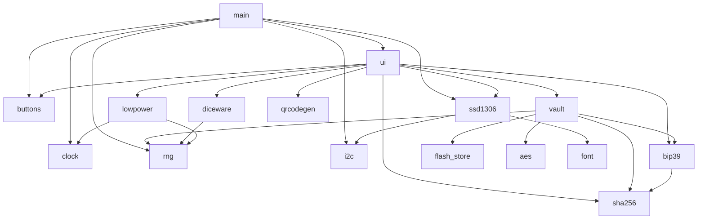
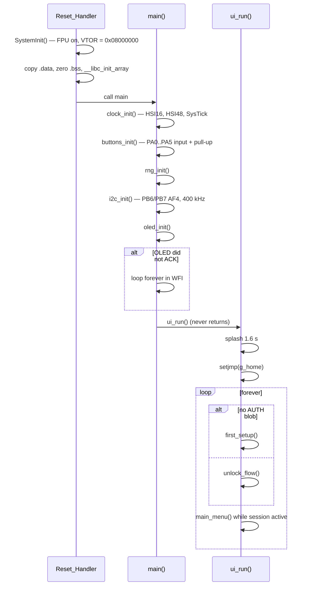
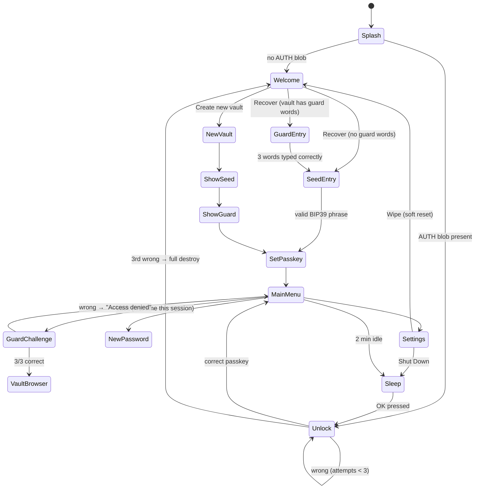
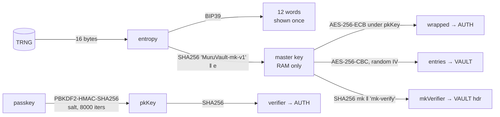
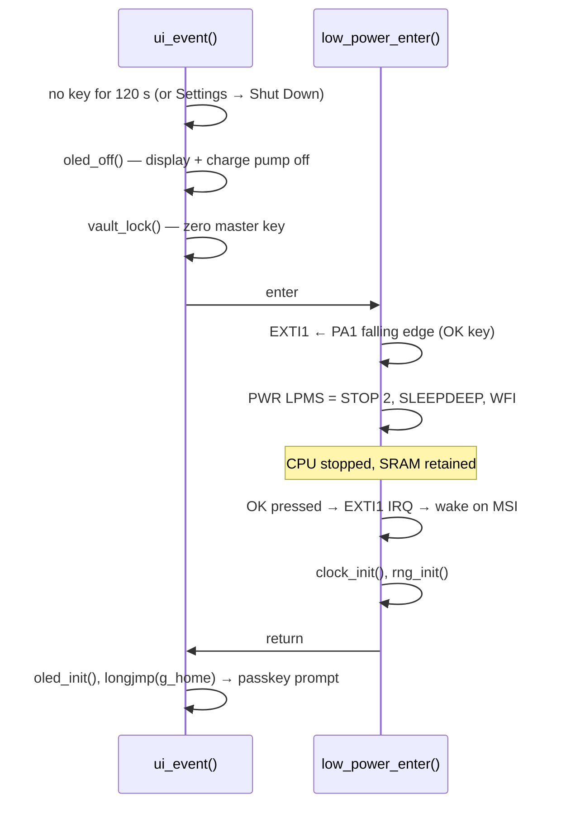

# Sentinel Vault firmware — internals

**Sentinel Vault** is an offline password generator and encrypted password vault for the
[Sentinel V1B](../hardware/sentinel-v1b.md) board. It is bare-metal C (no HAL, no RTOS), built with
`arm-none-eabi-gcc` and a plain Makefile.

- Source: [`Vault/Firmware/`](../../Vault/Firmware/)
- User guide (menus, controls, how to use): [`Vault/Firmware/README.md`](../../Vault/Firmware/README.md)
- Build & flash: [flashing.md](flashing.md)

This page documents **how the firmware works**: module structure, boot flow, storage format, cryptography,
UI/event model and power management.

---

## At a glance

| Item | Value |
|---|---|
| Target | STM32L442KCU6 (`-DSTM32L442xx`), Cortex‑M4F, hard-float ABI |
| Clock | HSI16 → 16 MHz SYSCLK, 0 flash wait states; HSI48 for the RNG |
| Timebase | SysTick 1 kHz (`millis()`, `delay_ms()` using `WFI`) |
| Display | SSD1306 over I²C1 @ 400 kHz, 1 KB framebuffer, 5×7 font (scalable ×2) |
| Input | 6 buttons, polled, 6 ms debounce, long-press + auto-repeat |
| Randomness | STM32 hardware TRNG, rejection sampling for uniform ranges |
| Crypto | Software SHA‑256, HMAC‑SHA256, PBKDF2‑HMAC‑SHA256, AES‑256 (ECB/CBC) |
| Storage | Top 8 KB of internal flash (4 × 2 KB pages) |
| USB / OPTIGA | **Not used** |
| Image size (current build) | 68.6 KB `.text`, 24 KB RAM incl. 1 KB heap + 4 KB stack reservation |

---

## Source tree

```
Vault/Firmware/
├── Makefile                 build → build/muru_vault.{elf,hex,bin,map}
├── linker/stm32l442.ld      248 KB code + 8 KB STORE region, 64 KB RAM
├── src/
│   ├── main.c               peripheral init → ui_run()
│   ├── board.h              pin map, timing prototypes
│   ├── ui.c / ui.h          all screens, menus, keyboard, app state machine
│   ├── vault.c / vault.h    identity, passkey wrap, entries, generator, guard words
│   ├── flash_store.c/.h     page erase / double-word program of the STORE region
│   ├── bip39.c/.h           12-word mnemonic ⇄ 128-bit entropy
│   ├── bip39_words.h        official BIP39 English list (2048)
│   ├── diceware.c/.h        Estonian passphrase generator
│   ├── estonian_words.h     curated Estonian list (2048)
│   ├── ssd1306.c/.h         display driver + framebuffer primitives
│   ├── font.c/.h            5×7 ASCII font
│   ├── buttons.c/.h         debounced event generator
│   ├── i2c.c/.h             blocking I²C1 master (write-only)
│   ├── rng.c/.h             TRNG driver
│   ├── clock.c              clocks + SysTick
│   ├── lowpower.c/.h        STOP 2 entry, OK-button wake
│   ├── qrcodegen.c/.h       QR encoder (MIT, R. Moore)
│   ├── crypto/sha256.c/.h   SHA-256, HMAC, PBKDF2 (+ progress callback)
│   ├── crypto/aes.c/.h      AES-256 block, CBC
│   ├── startup_stm32l442.s  vector table, reset handler
│   ├── system_stm32l4xx.c   SystemInit: FPU enable, VTOR
│   └── cmsis/               CMSIS core + device headers
└── tools/                   Estonian wordlist pipeline (Python)
```

### Module dependencies



---

## Boot sequence



`ui_run()` uses **`setjmp`/`longjmp`** as a global "go home" mechanism: idle sleep, Settings → Wipe, and
the 3-strike wipe all `longjmp(g_home)` back to the top of the loop, which clears the session and the
guard-word authorization.

---

## Application state machine



---

## Flash memory map

Defined in [`linker/stm32l442.ld`](../../Vault/Firmware/linker/stm32l442.ld) and
[`src/flash_store.c`](../../Vault/Firmware/src/flash_store.c) (keep them in sync).

| Address | Size | Region | Content |
|---|---|---|---|
| `0x0800_0000` | 248 KB | `FLASH` | vector table, code, rodata, `.data` init image |
| `0x0803_E000` | 2 KB (1 page) | `AUTH` | `AuthBlob` — passkey salt, verifier, wrapped master key, attempt counter |
| `0x0803_E800` | 2 KB (1 page) | `CFG` | `CfgBlob` — password generator settings |
| `0x0803_F000` | 4 KB (2 pages) | `VAULT` | `VaultHdr` + up to 28 encrypted entries |
| `0x2000_0000` | 64 KB | `RAM` | `.data`, `.bss`, 1 KB heap, 4 KB stack (top at `0x2001_0000`) |

Flash writes (`store_write`) always **erase the whole region, then program 64‑bit double-words**, with
interrupts disabled for the duration (bank-1 erase stalls instruction fetch).

### On-flash record formats

All multi-byte fields are little-endian.

**`AuthBlob` (96 bytes, region AUTH)**

| Offset | Size | Field | Notes |
|---|---|---|---|
| 0 | 4 | `magic` | `0x4D564131` (`'MVA1'`) |
| 4 | 16 | `salt` | random, regenerated on every passkey change |
| 20 | 32 | `verifier` | `SHA256(pkKey)` |
| 52 | 32 | `wrapped` | master key, AES‑256‑ECB encrypted under `pkKey` (2 blocks) |
| 84 | 1 | `rsvd[0]` | **wrong-attempt counter** |
| 85 | 1 | `rsvd[1]` | passkey kind: `0` typed passkey, `1` Estonian phrase |
| 86 | 10 | `rsvd[2..11]` | zero |

**`VaultHdr` (56 bytes, start of region VAULT)**

| Offset | Size | Field | Notes |
|---|---|---|---|
| 0 | 4 | `magic` | `0x4D565431` (`'MVT1'`) |
| 4 | 4 | `count` | number of entries (clamped to 28 on read) |
| 8 | 32 | `mkVerifier` | `SHA256(masterKey ‖ "mk-verify")` — identifies which seed owns this vault |
| 40 | 6 | `guard_idx[3]` | three `uint16` indices into the Estonian wordlist |
| 46 | 1 | `guard_set` | `1` once guard words are configured |
| 47 | 9 | `rsvd` | zero |

**Entry blob (144 bytes each, immediately after the header)**

| Offset | Size | Content |
|---|---|---|
| 0 | 16 | random IV |
| 16 | 128 | `AES‑256‑CBC(masterKey, IV, Entry)` |

where the plaintext `Entry` is `label[24] ‖ user[32] ‖ pass[64] ‖ pad[8]` (NUL-terminated strings).
Capacity: 56 + 28 × 144 = 4088 B ≤ 4096 B.

**`CfgBlob` (16 bytes, region CFG)** — `magic 0x4D564331 ('MVC1')`, `length`, `lower`, `upper`, `digits`,
`symbols`, 7 reserved bytes. Defaults when absent: length 20, all character sets on.

---

## Cryptography



| Secret | Derivation | Where it lives |
|---|---|---|
| Entropy (128 bit) | `rng_fill()` from the STM32 TRNG | never stored; shown once as 12 BIP39 words |
| Master key (256 bit) | `SHA256("MuruVault-mk-v1" ‖ entropy)` | RAM (`g_master`) only while unlocked; zeroed by `vault_lock()` |
| Passkey key `pkKey` | `PBKDF2‑HMAC‑SHA256(passkey, salt16, 8000, 32)` | transient, zeroed after use |
| Passkey check | `SHA256(pkKey)` compared with `verifier` | AUTH page |
| Wrapped master key | `AES‑256‑ECB_pkKey(masterKey)` | AUTH page |
| Entries | `AES‑256‑CBC_masterKey(IV, Entry)` | VAULT pages |

Implementation notes:

- **BIP39** — standard 128-bit entropy + 4-bit SHA‑256 checksum → 12 words from the official English list
  (the list's SHA‑256 is recorded in `bip39_words.h`). Note that Muru Vault derives its key with its own
  domain-separated SHA‑256, **not** the BIP39 PBKDF2 seed — the same 12 words used in a crypto wallet would produce
  unrelated keys, and vice versa.
- **PBKDF2** reports progress through `pbkdf2_set_progress()`, which the UI uses to draw a progress bar during
  *Securing key* / *Unlocking* (8000 iterations at 16 MHz take a few seconds).
- **`rng_below(n)`** discards values ≥ `2³² − (2³² mod n)` so password characters, Diceware words and guard-word
  decoys are uniformly distributed.
- **Zeroization** uses a `volatile` byte loop (`memzero`) for keys and plaintext buffers.

### Anti-brute-force

`unlock_flow()` does:

1. read the attempt counter; if **≥ 3 → `vault_destroy_all()`** (erase AUTH, CFG and VAULT) and show *"device wiped"*;
2. **increment and persist** the counter *before* running PBKDF2, so cutting power mid-check does not reset it;
3. on success reset the counter to 0.

### Wipe vs. destroy

| Action | AUTH | CFG | VAULT (ciphertext + guard words) | Recoverable with 12 words? |
|---|---|---|---|---|
| Settings → **Wipe** (`vault_soft_reset`) | erased | erased | **kept** | ✅ yes (guard words required first) |
| **3 wrong passkeys** (`vault_destroy_all`) | erased | erased | erased | ❌ no — vault is gone |
| **Recover** with a different seed | — | — | replaced by an empty vault | n/a |

`vault_recover()` keeps the existing VAULT only if `mkVerifier` matches the master key derived from the entered phrase.

### Guard words

Three distinct random indices into the Estonian list, generated at vault creation and stored **in plaintext** in the
vault header (the device must know them to build the multiple-choice challenge):

- **Opening the saved-password list:** 3 rounds of *pick the right word out of 3* (correct word + 2 random decoys,
  random position). All three must be right, in order. Authorization lasts until the next lock/sleep.
- **Recovery:** the user must type all three words, space-separated, in order, before the seed-phrase prompt.

This is a usability gate, not a cryptographic layer (1 in 27 to guess the challenge; readable from a flash dump).

---

## User interface

### Button events (`buttons.c`)

`read_event()` scans all six keys every call and then sleeps 6 ms (debounce). It returns at most one event:

| Key type | Event emitted |
|---|---|
| Directional (UP/DOWN/LEFT/RIGHT) | on **press**, then auto-repeat after **420 ms** every **110 ms** |
| OK / BACK | `EV_OK` / `EV_BACK` on **release** if held < 550 ms; `EV_OK_LONG` / `EV_BACK_LONG` once at **550 ms** |

Every edge updates `last_activity_ms()`, which drives the idle timer.

### Screens and widgets (`ui.c`)

| Widget | Behaviour |
|---|---|
| `menu()` | scrolling list, 5 visible rows, ▲▼ indicators; OK selects, BACK returns −1 |
| `get_text()` | on-screen QWERTY: 3 letter rows + function row (`cap` `123` `spc` `del`); symbol layer `1234567890` / `!@#$%^&*()` / `-_=+.,?/:;`; typed text shown at 2× size, tail-visible, optionally masked; max 159 characters; **hold OK = accept, hold BACK = cancel** |
| `busy_*()` | header + progress bar + percentage + spinner, driven by the PBKDF2 progress hook |
| `draw_qr()` | QR version 3 / ECC‑M (fallback version 4 / ECC‑L), 1 px modules with a 2-module quiet zone |
| `show_seed()` | 12 words over 2 pages of 6, must page through to finish |

Password generator: length **8–63** (default 20), character sets `a‑z`, `A‑Z`, `0‑9`,
symbols `!@#$%^&*()-_=+[]{};:,.?/`. Settings are saved to CFG when leaving the screen.

Estonian passphrase: **4–8 words** (default 6, 11 bits per word, 44–88 bits), regenerate with OK, accept with hold OK.
The phrase becomes the passkey and goes through the same PBKDF2 path. Minimum typed passkey length is 4 characters.

---

## Power management (`lowpower.c`)



In STOP 2 the MCU draws a few µA; the remaining standby current is dominated by the always-on parts
(LDO quiescent current, OPTIGA, OLED controller in sleep, charger/protection ICs). For true zero drain, use the
slide switch.

---

## Peripheral drivers

| Driver | Registers / settings |
|---|---|
| `clock.c` | `FLASH->ACR` 0 WS + prefetch + caches; `RCC_CR.HSION`, `SW = HSI`; `RCC_CRRCR.HSI48ON`; SysTick reload 15999 |
| `i2c.c` | GPIOB PB6/PB7 AF4 open-drain, pull-up, very-high speed; `TIMINGR = 0x0010061A` (400 kHz @ 16 MHz); write-only, AUTOEND/RELOAD for > 255 bytes, bounded busy-waits |
| `ssd1306.c` | init sequence: mux 1/64, charge pump on, horizontal addressing, **`0xA0` + `0xC0` (180° rotation for V1B)**, contrast `0xCF`; `oled_flush()` sends the full 1024-byte framebuffer in one transfer |
| `rng.c` | `RCC_AHB2ENR.RNGEN`, `RNG_CR.RNGEN`; on seed/clock error clears flags and re-enables |
| `flash_store.c` | `FLASH->KEYR` unlock, `PER`+`PNB` page erase, `PG` double-word program, error-flag checks |
| `lowpower.c` | `SYSCFG_EXTICR1` line 1 → port A, `EXTI_FTSR1.FT1`, `PWR_CR1.LPMS = 010` |

Not used / not initialised: USB, OPTIGA (PB0 left in reset state), hardware AES, RTC, watchdog.

---

## Estonian wordlist tooling (`tools/`)

| Script | Purpose |
|---|---|
| `make_estonian_wordlist.py` | Generates a *candidate* list + C header from a frequency corpus (lowercase → Estonian letters only → ASCII-fold õäöüšž → length 4–8 → drop words containing c/q/w/x/y/z/f → unique 4-letter prefixes → first 2048 → sort) |
| `curate_estonian.py` | Same pipeline plus removal of first names (`tools/first-names.txt`), a manual surname/place/English-artifact blocklist and profanity stems; writes `build/estonian_2048.txt` |
| `validate_wordlist.py` | Checks: exactly 2048 words, ASCII alphabetic, length 4–8, unique 4-letter prefixes, no duplicates, sorted. Prints `VALID` or the problems |

Input corpus: `build/et_50k_freq.txt` (OpenSubtitles 2018 via hermitdave/FrequencyWords). It and the generated
`build/*.txt` lists are not committed — download the corpus from
`https://raw.githubusercontent.com/hermitdave/FrequencyWords/master/content/2018/et/et_50k.txt` before re-running the pipeline.
`src/estonian_words.h` is a drop-in table — replacing it changes nothing else in the firmware.

---

## Extending the firmware

- **Porting to V1C (STM32U585):** replace CMSIS headers/startup/linker, rewrite `clock.c`, `flash_store.c`
  (U5 flash uses 8 KB pages and quad-word programming), swap `PIN_LEFT`/`PIN_RIGHT` in `board.h`, and remove the
  180° display flip if the OLED is mounted on top.
- **Moving secrets into the OPTIGA:** `flash_store.c` / `vault.c` are deliberately the only modules that touch
  persistent state; the README's roadmap is to put the wrapped master key in a protected data object, use the OPTIGA
  TRNG, and replace the flash attempt counter with an OPTIGA monotonic counter.
- **Production hardening:** raise RDP to Level 2, add an IWDG, and consider an authenticated mode (e.g. AES‑GCM or
  encrypt-then-MAC) for entries.
