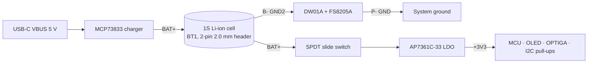

# Common circuits

Both Sentinel boards — **V1B** (STM32L442) and **V1C / 2MB** (STM32U585) — are built from the same circuit blocks.
This page describes each block once. Reference designators are given for both boards as **V1B / V1C**.

- [Power path overview](#power-path-overview)
- [USB‑C receptacle](#usb-c-receptacle)
- [Li‑ion charger (MCP73833)](#li-ion-charger-mcp73833)
- [Battery protection (DW01A + FS8205A)](#battery-protection-dw01a--fs8205a)
- [Power switch and 3.3 V LDO](#power-switch-and-33-v-ldo)
- [MCU support circuitry](#mcu-support-circuitry)
- [OLED display](#oled-display)
- [OPTIGA Trust M secure element](#optiga-trust-m-secure-element)
- [Buttons](#buttons)
- [SWD programming port (Tag‑Connect)](#swd-programming-port-tag-connect)

---

## Power path overview

| Net | Meaning |
|---|---|
| `VBUS` | 5 V from USB‑C. Feeds **only** the charger, the ESD diode reference and the charge LEDs. The MCU does **not** sense VBUS. |
| `BAT+` | Battery positive / charger output. Always live while a cell is fitted (charger, protection IC and — on V1C — the fuel gauge stay powered when the device is "off"). |
| `GND2` | Battery negative (B−), before the protection MOSFETs. |
| `GND` | System ground (P−), after the protection MOSFETs. |
| `+3V3` | Regulated rail after the power switch. |

The charger output is tied directly to `BAT+`, so **the cell charges even when the slide switch is off**, and the
device runs from the charger/cell when USB is connected and the switch is on.

---

## USB-C receptacle

| Part | V1B | V1C | Notes |
|---|---|---|---|
| USB‑C 2.0 16‑pin receptacle (HCTL HC‑TYPE‑C‑16P‑01A) | J1 | J2 | Both D+/D− pairs joined (orientation-agnostic) |
| CC pull-downs 5.1 kΩ | R6, R7 | R6, R7 | One per CC pin → advertises a **sink/device**, up to default USB power |
| ESD array USBLC6‑2SC6 | U8 | U5 | Protects D+ / D−; VBUS pin used as clamp reference |
| VBUS bulk caps 10 µF | C6, C7 | C12, C19 | |

Data lines are routed to the MCU's USB FS peripheral: **PA11 = D−, PA12 = D+** on both boards.
SBU1/SBU2 are unconnected. Shield is tied to `GND`.

> The Muru Vault firmware does not use USB at all (it is an "air‑gapped" design); the prebuilt Sentinel Core
> wallet firmware uses it as its host link.

---

## Li-ion charger (MCP73833)

Microchip **MCP73833‑FCI/MF** — linear single-cell Li‑ion/Li‑Po charge-management controller, DFN‑10 3×3 mm.

| Function | Pin | V1B | V1C | Value / behaviour |
|---|---|---|---|---|
| Supply | VDD (1, 2) | — | — | `VBUS` |
| Battery output | VBAT (9, 10) | — | — | `BAT+` |
| Charge current | PROG (6) | R9 | R15 | **4 kΩ → IREG = 1000 V / 4 kΩ ≈ 250 mA** |
| Thermistor input | THERM (8) | R8 | R14 | 10 kΩ fixed resistor to GND (no NTC — temperature qualification effectively disabled) |
| Status 1 | STAT1 (3) | D2 red + R5 1 kΩ | D1 red + R9 1 kΩ | **Red = charging** |
| Status 2 | STAT2 (4) | D1 green + R4 1 kΩ | D2 green + R10 1 kΩ | **Green = charge complete** |
| Power-good | PG (7) | — | — | Not connected |

The LED anodes are powered from `VBUS`, so the LEDs only light while USB is connected, and they cost nothing from the battery.

> The 250 mA setting suits small (≈ 250–1000 mAh) pouch cells. For a larger cell, lower the PROG resistor
> (e.g. 2 kΩ → 500 mA) — but keep the current ≤ 1 C of the chosen cell.

---

## Battery protection (DW01A + FS8205A)

The classic one-cell protection pair:

| Part | V1B | V1C | Role |
|---|---|---|---|
| DW01A | U5 | U7 | Over-charge / over-discharge / over-current detector |
| FS8205A | U4 | U6 | Dual N‑MOSFET (common drain) in the negative lead |
| 2 kΩ current-sense resistor | R10 | R8 | DW01A `CS` → `GND` (P−) |
| 0.1 µF VCC bypass | C8 | C13 | DW01A `VCC` → `GND2` (B−) |

Connections (identical on both boards):

| FS8205A pin | Net |
|---|---|
| G1 | DW01A **OD** (`upper-FET gate`) |
| S1 | `GND` (P−) |
| G2 | DW01A **OC** (`lower-FET gate`) |
| S2 | `GND2` (B−) |
| D1D2 | common drain (internal) |

> ⚠️ **Review note:** in the usual DW01A reference circuit the **OD**‑driven FET has its source on **B−** and the
> **OC**‑driven FET has its source on **P−**. Here it is the other way round. See
> [review notes](../review-notes.md#h1-battery-protection-mosfets-appear-swapped) — worth checking against the
> FS8205A / DW01A datasheets before the next PCB spin.

---

## Power switch and 3.3 V LDO

| Part | V1B | V1C | Notes |
|---|---|---|---|
| SPDT slide switch, C&K OS102011MA1Q (right-angle, THT) | SW1 | SW7 | Common = `BAT+`, B = LDO input, A = unconnected |
| AP7361C‑33E LDO (Diodes Inc., 3.3 V, 1 A, SOT‑223) | U6 | U8 | |
| LDO input cap 0.1 µF | C16 | C15 | |
| LDO output cap 22 µF | C11 | C16 | |
| +3V3 decoupling 0.1 µF | C12, C13, C15 | C2, C4, C5, C6, C8 | |

On V1B the slide switch is mounted on the **back** of the board; on V1C it is on the top.

---

## MCU support circuitry

| Function | V1B (STM32L442KCU6) | V1C (STM32U585CIT6) |
|---|---|---|
| Analog supply filter | FB1 600 Ω @ 100 MHz ferrite → VDDA, C17 0.1 µF + C18 10 µF | FB1 → VDDA (pin 9), C9 10 µF + C10 0.1 µF |
| Core regulator cap | — (none needed) | VCAP: C3 2.2 µF |
| VBAT | — (not on UFQFPN‑32) | tied to `+3V3` |
| BOOT0 | R11 10 kΩ to GND → always boots from main flash | R2 10 kΩ to GND |
| NRST | C14 0.1 µF to GND + Tag‑Connect pin 3 | C7 0.1 µF to GND + Tag‑Connect pin 3 |
| Clocks | No crystals: HSI16 / MSI core, HSI48 for RNG/USB | No crystals (HSE/LSE pins unconnected) |

Both boards are **crystal-less**; USB FS can run from HSI48 trimmed by the clock-recovery system (CRS).

---

## OLED display

`DS1` is a **raw 0.96" 128×64 OLED glass** (KiCad footprint `OLED-128O064D`, 30‑pin FPC) with an on-glass
**SSD1306** controller — not a pre-made module.

| SSD1306 pin(s) | Connection | Effect |
|---|---|---|
| BS0 = 0, BS1 = 1, BS2 = 0 | GND / +3V3 / GND | **I²C interface** selected |
| D/C# | GND | I²C address **0x3C** (7‑bit) |
| D0 | `SCL` | I²C clock |
| D1 + D2 | `SDA` | I²C data (D1 = SDA in, D2 = SDA out, tied together) |
| CS#, R/W#, E/RD#, D3–D7 | GND | unused in I²C mode |
| RES# | +3V3 | **No reset control** — relies on power-on |
| VDD, VBAT | +3V3 | logic + internal charge-pump input |
| C1P/C1N, C2P/C2N | 2.2 µF ×2 (V1B C1, C2 · V1C C17, C18) | charge-pump flying caps |
| VCC | 0.1 µF + 2 µF (V1B C4, C5 · V1C C22, C23) | charge-pump output (panel drive) |
| VCOMH | 1 µF (V1B C3 · V1C C20) | |
| IREF | 390 kΩ to GND (V1B R3 · V1C R13) | segment current reference |

The firmware enables the internal charge pump (`0x8D 0x14`).
I²C pull-ups: **4.7 kΩ** to +3V3 (V1B R1/R2 · V1C R11/R12).

> On **V1B the display is soldered on the back of the board, upside-down**, so the Muru Vault firmware initialises the
> SSD1306 rotated 180° (segment remap `0xA0`, COM scan `0xC0`).

---

## OPTIGA Trust M secure element

Infineon **SLS32AIA010MLUSON10XTMC1** — OPTIGA™ Trust M, general-purpose configuration, CC EAL6+,
10 kB user memory, extended temperature (−40…+105 °C), PG‑USON‑10 (3×3 mm), I²C address **0x30**.

| OPTIGA pin | Function | V1B | V1C |
|---|---|---|---|
| 10 VCC | supply | `+3V3` (always on) | `+3V3_OPTIGA` (switched by NCP380, see V1C doc) |
| 1, 11 GND / EP | ground | GND | GND |
| 8 SCL | I²C clock | shared `SCL` (PB6) | dedicated `SCL2` (PB10) |
| 3 SDA | I²C data | shared `SDA` (PB7) | dedicated `SDA2` (PB14) |
| 9 RST# | reset | PB0 | PB0 |

What the OPTIGA is (and isn't) for in Sentinel is discussed in [`Vault/ARCHITECTURE.md`](../../Vault/ARCHITECTURE.md):
it **cannot sign secp256k1 / ed25519**, so its role is protected storage, certified TRNG, monotonic
anti-rollback counters and the encrypted "Shielded Connection" I²C link.

---

## Buttons

Six **XKB TS‑1187A** 4‑pin SMD tactile switches, each shorting a GPIO to GND.
No external resistors — the MCU's **internal pull-ups** are used (active‑LOW).

| Key | V1B ref → pin | V1C ref → pin |
|---|---|---|
| UP | SW2 → **PA0** | SW1 → **PA0** |
| OK | SW3 → **PA1** | SW2 → **PA1** |
| DOWN | SW4 → **PA2** | SW3 → **PA2** |
| RIGHT | SW5 → **PA3** | SW4 → **PA4** ⚠️ |
| LEFT | SW6 → **PA4** | SW5 → **PA3** ⚠️ |
| BACK | SW7 → **PA5** | SW6 → **PA5** |

> ⚠️ LEFT and RIGHT are **swapped** between V1B and V1C. Firmware ported to V1C must swap `PIN_LEFT` / `PIN_RIGHT`.

PA1 (OK) is the wake-up key in the Muru Vault firmware (EXTI line 1).

---

## SWD programming port (Tag-Connect)

Footprint: **Tag‑Connect TC2030‑IDC‑NL** (no-legs, 2×3, 1.27 mm). V1B = **J2**, V1C = **J1**.

| TC2030 pin | Signal | MCU pin |
|---|---|---|
| 1 | VCC (+3V3) — target voltage sense | — |
| 2 | SWDIO | PA13 |
| 3 | NRST | NRST |
| 4 | SWCLK | PA14 |
| 5 | GND | — |
| 6 | SWO | not connected |

Use a TC2030‑NL cable with an ST‑LINK (or a TC2030‑to‑ARM‑10‑pin adapter). The board must be powered
(switch on, or USB connected with the switch on) — the VCC pin is only a reference for the probe.
