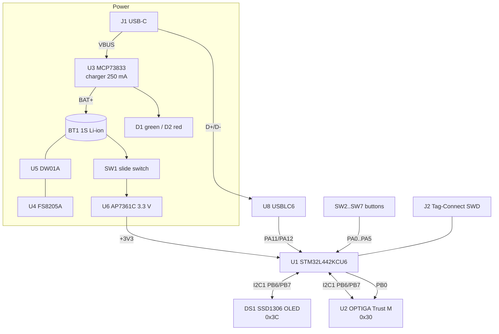

# Sentinel V1B — STM32L442 board

The first fabricated Sentinel board. Silkscreen: **"SENTINEL V1B" · "by Papathought" · "muru.global"**
(and, under the display, *"If you're reading this / You've voided the warranty"*).

| | |
|---|---|
| KiCad project | [`Vault/STM32 Cold Wallet.kicad_pro`](../../Vault/STM32%20Cold%20Wallet.kicad_pro) (KiCad 10) |
| Schematic | [`Vault/STM32 Cold Wallet.kicad_sch`](../../Vault/STM32%20Cold%20Wallet.kicad_sch) — single sheet |
| PCB | [`Vault/STM32 Cold Wallet.kicad_pcb`](../../Vault/STM32%20Cold%20Wallet.kicad_pcb) |
| Netlist | not committed — export with *File → Export → Netlist* or `kicad-cli sch export netlist` |
| Fabrication | [`Vault/Sentinel-V1B Gerber.zip`](../../Vault/Sentinel-V1B%20Gerber.zip) |
| Firmware | [Muru Vault](../firmware/muru-vault.md) (source) · [Sentinel Core](../firmware/sentinel-core.md) (binary) |

---

## Block diagram

---

## Key components

| Ref | Part | Package | Function |
|---|---|---|---|
| U1 | **STM32L442KCU6** | UFQFPN‑32 (5×5) | Cortex‑M4F @ up to 80 MHz, 256 KB flash, 64 KB SRAM, HW AES‑256, TRNG, USB FS device |
| U2 | **OPTIGA Trust M** SLS32AIA010MLUSON10XTMC1 | PG‑USON‑10 (3×3) | Secure element, I²C 0x30 |
| U3 | MCP73833‑FCI/MF | DFN‑10 (3×3) | Li‑ion charger |
| U4 | FS8205A | SOT‑23‑6 | Dual N‑MOSFET (battery protection) |
| U5 | DW01A | SOT‑23‑6 | Battery protection controller |
| U6 | AP7361C‑33E | SOT‑223 | 3.3 V 1 A LDO |
| U8 | USBLC6‑2SC6 | SOT‑23‑6 | USB ESD protection |
| DS1 | 0.96" 128×64 OLED (SSD1306) | 30‑pin FPC | Display (I²C 0x3C), **mounted on the back** |
| J1 | USB‑C 2.0 receptacle | HC‑TYPE‑C‑16P‑01A | Charging + USB data |
| J2 | Tag‑Connect TC2030‑NL | 2×3 pads | SWD programming |
| SW1 | C&K OS102011MA1Q | THT right-angle | Power on/off, **mounted on the back** |
| SW2–SW7 | XKB TS‑1187A | SMD | UP, OK, DOWN, RIGHT, LEFT, BACK |
| BT1 | 2‑pin 2.0 mm header | THT | Battery connection |
| FB1 | 600 Ω @ 100 MHz ferrite (MCL2012V1) | 0805 | VDDA filter |

All passives are **0805**. Full bill of materials: [BOM](#bill-of-materials).

---

## STM32L442KCU6 pin map

| Pin | Name | Net / function | Notes |
|---|---|---|---|
| 1 | VDD | +3V3 | |
| 2 | PC14‑OSC32_IN | — | no LSE crystal |
| 3 | PC15‑OSC32_OUT | — | |
| 4 | NRST | NRST | C14 0.1 µF, Tag‑Connect pin 3 |
| 5 | VDDA/VREF+ | +3V3 via FB1 | C17 0.1 µF, C18 10 µF |
| 6 | PA0 | `SWUP` | Button **UP** |
| 7 | PA1 | `SWOK` | Button **OK** (wake-up source) |
| 8 | PA2 | `SWDW` | Button **DOWN** |
| 9 | PA3 | `SWRG` | Button **RIGHT** |
| 10 | PA4 | `SWLF` | Button **LEFT** |
| 11 | PA5 | `SWBC` | Button **BACK** |
| 12, 13 | PA6, PA7 | — | free |
| 14 | PB0 | `PB0/RST` | OPTIGA reset |
| 15 | PB1 | — | free |
| 16, 32, 33 | VSS, EP | GND | |
| 17 | VDD | +3V3 | |
| 18–20 | PA8–PA10 | — | free |
| 21 | PA11 | USB D− | via U8 |
| 22 | PA12 | USB D+ | via U8 |
| 23 | PA13 | SWDIO | Tag‑Connect pin 2 |
| 24 | PA14 | SWCLK | Tag‑Connect pin 4 |
| 25 | PA15 | — | free |
| 26–28 | PB3–PB5 | — | free (PB3 = SWO, not routed) |
| 29 | PB6 | `SCL` | I²C1 SCL (AF4) — OLED + OPTIGA, 4.7 kΩ pull-up R1 |
| 30 | PB7 | `SDA` | I²C1 SDA (AF4) — OLED + OPTIGA, 4.7 kΩ pull-up R2 |
| 31 | PH3/BOOT0 | R11 10 kΩ → GND | boots from flash |

Free GPIOs for future use: PA6, PA7, PA8, PA9, PA10, PA15, PB1, PB3, PB4, PB5.

### I²C bus

| Address (7‑bit) | Device |
|---|---|
| `0x30` | OPTIGA Trust M (U2) |
| `0x3C` | SSD1306 OLED (DS1) |

Both devices share **I²C1** at up to 400 kHz with 4.7 kΩ pull-ups to +3V3.

---

## PCB

| Property | Value |
|---|---|
| Layers | 2 (F.Cu, B.Cu) |
| Thickness | 1.6 mm |
| Outline | ≈ 45.3 × 73.8 mm |
| Track widths used | 0.2, 0.3, 0.4, 0.5, 0.6 mm |
| Vias | 102 |
| Footprints | 66 (incl. test points) |

**Back side (B.Cu)** carries: the OLED (DS1), the slide switch (SW1) and test pads.

### Test points (back side, 1.0 × 1.0 mm pads)

| Test point | Net |
|---|---|
| `BAT+` | battery positive |
| `GND2` | battery negative (B−, before protection FETs) |
| `VBUS` | USB 5 V |
| `VDDA` | MCU analog supply (after ferrite) |
| `DSVCC` | OLED charge-pump output (VCC) |
| `BOOT0` | BOOT0 pin — bridge to +3V3 to enter the ST system bootloader |

### Gerber package

`Sentinel-V1B Gerber.zip` contains: F/B copper, F/B mask, F/B paste, F/B silkscreen, Edge.Cuts,
PTH + NPTH drill files and a `.gbrjob` job file — ready to upload to common PCB fabs.

---

## Electrical rules check

[`Vault/ERC.rpt`](../../Vault/ERC.rpt) reports **21 errors, 0 warnings**, all of them benign:

| Type | Count | Cause |
|---|---|---|
| `pin_not_connected` | 14 | Unused MCU pins, SW1 pin A, MCP73833 PG — need *no-connect* flags |
| `power_pin_not_driven` | 6 | Rails fed through switches/ferrite/charger without a `PWR_FLAG` |
| `pin_not_driven` | 1 | FS8205A common-drain pin (internal node) |

Adding no-connect markers and `PWR_FLAG` symbols would make the ERC clean.

---

## Bill of materials

| Qty | References | Value | Footprint |
|---|---|---|---|
| 1 | U1 | STM32L442KCU6 | UFQFPN‑32 5×5 (QFN50P500X500X60‑33N) |
| 1 | U2 | SLS32AIA010MLUSON10XTMC1 (OPTIGA Trust M) | USON‑10 3×3 |
| 1 | U3 | MCP73833‑FCI/MF | DFN‑10 3×3 |
| 1 | U4 | FS8205A | SOT‑23‑6 |
| 1 | U5 | DW01A | SOT‑23‑6 |
| 1 | U6 | AP7361C‑33E | SOT‑223‑3 |
| 1 | U8 | USBLC6‑2SC6 | SOT‑23‑6 |
| 1 | DS1 | OLED 128×64 SSD1306 (OLED‑128O064D) | 30‑pin FPC |
| 1 | J1 | USB‑C receptacle USB 2.0 16P (HCTL HC‑TYPE‑C‑16P‑01A) | SMD |
| 1 | J2 | Tag‑Connect TC2030‑IDC‑NL | pads |
| 1 | SW1 | SPDT slide, C&K OS102011MA1Q | THT right-angle |
| 6 | SW2–SW7 | Tactile switch XKB TS‑1187A | SMD |
| 1 | BT1 | Battery connector | 1×2 2.00 mm header |
| 1 | FB1 | Ferrite 600 Ω @ 100 MHz | 0805 (MCL2012V1) |
| 1 | D1 | Green LED | 0805 |
| 1 | D2 | Red LED | 0805 |
| 2 | C1, C2 | 2.2 µF | 0805 |
| 1 | C3 | 1 µF | 0805 |
| 8 | C4, C8, C12–C17 | 0.1 µF | 0805 |
| 1 | C5 | 2 µF | 0805 |
| 5 | C6, C7, C9, C10, C18 | 10 µF | 0805 |
| 1 | C11 | 22 µF | 0805 |
| 2 | R1, R2 | 4.7 kΩ | 0805 |
| 1 | R3 | 390 kΩ | 0805 |
| 2 | R4, R5 | 1 kΩ | 0805 |
| 2 | R6, R7 | 5.1 kΩ | 0805 |
| 2 | R8, R11 | 10 kΩ | 0805 |
| 1 | R9 | 4 kΩ | 0805 |
| 1 | R10 | 2 kΩ | 0805 |

Plus: one single-cell Li‑ion / Li‑Po battery with a 2.0 mm 2‑pin lead.

---

## Differences from the design plan

[`ARCHITECTURE.md`](../../Cold%20Wallet/Hardware/ARCHITECTURE.md) was written before the layout. The as-built V1B differs:

| Plan (ARCHITECTURE.md) | As built (V1B) |
|---|---|
| Separate charging module, wallet board needs its own data USB‑C | Charger + protection **integrated** on the board; **one** USB‑C for both charge and data |
| TPS7A02 / MCP1700 ultra-low-Iq LDO | **AP7361C‑33E** (1 A, higher Iq) |
| Buttons: Up PA0, Down PA1, OK PA2, Back PA3, Left PA4, Right PA5 | Up PA0, **OK PA1**, **Down PA2**, **Right PA3**, Left PA4, **Back PA5** |
| Optional case-tamper input | Not implemented |
