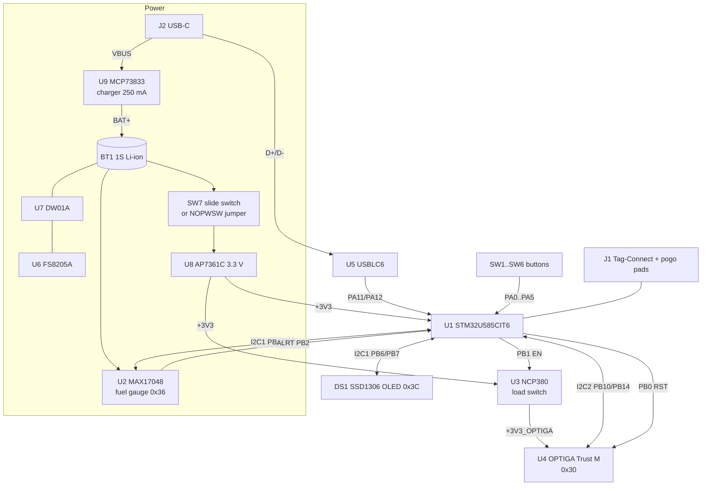

# Sentinel V1C ("2MB") — STM32U585 board

The next-generation Sentinel board, designed to remove the flash limit of V1B (the prebuilt wallet image already
uses ~88 % of the STM32L442's 256 KB) and to harden the secure-element interface.

Silkscreen: **"SENTINEL V1C" · "by Papathought" · "muru.global"**.
Schematic title block: *Sentinel*, rev *V1A*, company *muru.global*, dated 2026‑09‑22.

| | |
|---|---|
| KiCad project | [`Cold Wallet/Hardware/STM32 2MB Cold Wallet.kicad_pro`](../../Cold%20Wallet/Hardware/STM32%202MB%20Cold%20Wallet.kicad_pro) (KiCad 10) |
| Schematic | [`STM32 2MB Cold Wallet.kicad_sch`](../../Cold%20Wallet/Hardware/STM32%202MB%20Cold%20Wallet.kicad_sch) — one sheet, sections *USB‑C CONNECTOR, POWER MANAGEMENT, SECURITY & AUTH, MCU, PROGRAMMING, CONTROLS, DISPLAY* |
| PCB | [`STM32 2MB Cold Wallet.kicad_pcb`](../../Cold%20Wallet/Hardware/STM32%202MB%20Cold%20Wallet.kicad_pcb) |
| 3D | [`Cold Wallet/3D/`](../../Cold%20Wallet/3D/) — STL/GLB of the assembled board (with and without power switch), Blender render scene, case + flashing-rig model |
| Firmware | none yet (`Cold Wallet/Firmware/` is empty) |
| Status | Design / pre-production — no Gerbers exported yet |

> ℹ️ The netlist files that sat next to this project predated the schematic's re-annotation and are excluded from the
> repository. All designators below come from the current `.kicad_sch`; export a fresh netlist if you need one.

---

## What changed vs. V1B

| Area | V1B | **V1C** |
|---|---|---|
| MCU | STM32L442KCU6 (M4F, 256 KB / 64 KB, UFQFPN‑32) | **STM32U585CIT6** (Cortex‑M33 160 MHz, **TrustZone**, **2 MB flash / 786 KB SRAM**, LQFP‑48) |
| MCU crypto HW | AES, TRNG | AES, **SAES**, **PKA** (ECC/RSA accel.), **HASH**, TRNG, OTFDEC |
| OPTIGA bus | shares I²C1 with the OLED | **dedicated I²C2** (PB10/PB14) — the secret-carrying bus is isolated from the display bus |
| OPTIGA power | always on | **NCP380 load switch** controlled by PB1 → SE can be hard-reset / powered off; 10 kΩ bleed resistor on the switched rail |
| Battery monitoring | none | **MAX17048** fuel gauge on I²C1, alert → PB2 |
| Power switch | slide switch on back | slide switch on top + **NOPWSW** solder jumper to bypass it |
| Programming | Tag‑Connect only | Tag‑Connect **+ 4 large pogo pads** (GND/3V3/SWDIO/SWCLK) for a flashing rig |
| Mechanical | no mounting holes | **3 × M2** mounting holes |
| PCB | 2 layers, 45.3 × 73.8 mm, parts on both sides | **4 layers**, 39.1 × 73.8 mm, **all parts on top** |
| Buttons | RIGHT = PA3, LEFT = PA4 | **LEFT = PA3, RIGHT = PA4** (swapped) |

---

## Block diagram

---

## Key components

| Ref | Part | Package | Function |
|---|---|---|---|
| U1 | **STM32U585CIT6** | LQFP‑48 7×7 | Cortex‑M33 + TrustZone, 2 MB flash, 786 KB SRAM, USB FS |
| U2 | **MAX17048G+T10** | TDFN‑8 2×2 | ModelGauge™ single-cell fuel gauge, I²C 0x36 |
| U3 | **NCP380HSNAJAAT1G** | TSOP‑6 | Current-limited load switch (active-high EN), powers the OPTIGA |
| U4 | **OPTIGA Trust M** SLS32AIA010MLUSON10XTMC1 | USON‑10 3×3 | Secure element, I²C 0x30 |
| U5 | USBLC6‑2SC6 | SOT‑23‑6 | USB ESD |
| U6 | FS8205A | SOT‑23‑6 | Battery protection MOSFETs |
| U7 | DW01A | SOT‑23‑6 | Battery protection controller |
| U8 | AP7361C‑33E | SOT‑223 | 3.3 V LDO |
| U9 | MCP73833‑FCI/MF | DFN‑10 3×3 | Li‑ion charger |
| DS1 | 0.96" 128×64 OLED (SSD1306) | 30‑pin FPC | Display, I²C 0x3C |
| J1 | Tag‑Connect TC2030‑NL | pads | SWD |
| J2 | USB‑C 2.0 receptacle | HC‑TYPE‑C‑16P‑01A | Charging + USB data |
| SW1–SW6 | XKB TS‑1187A | SMD | UP, OK, DOWN, RIGHT, LEFT, BACK |
| SW7 | C&K OS102011MA1Q | THT right-angle | Power on/off |

Shared blocks (charger, protection, LDO, OLED, USB, buttons, SWD) are described in
[Common circuits](common-circuits.md).

---

## STM32U585CIT6 pin map

| Pin | Name | Net / function | Notes |
|---|---|---|---|
| 1 | VBAT | +3V3 | no backup battery |
| 2 | PC13 | — | free (RTC tamper-capable) |
| 3, 4 | PC14 / PC15 | — | no LSE crystal |
| 5, 6 | PH0 / PH1 | — | no HSE crystal |
| 7 | NRST | NRST | C7 0.1 µF, Tag‑Connect pin 3 |
| 8 | VSSA | GND | |
| 9 | VDDA | +3V3 via FB1 | C9 10 µF, C10 0.1 µF |
| 10 | PA0 | `SWUP` | Button **UP** |
| 11 | PA1 | `SWOK` | Button **OK** |
| 12 | PA2 | `SWDW` | Button **DOWN** |
| 13 | PA3 | `SWLF` | Button **LEFT** |
| 14 | PA4 | `SWRG` | Button **RIGHT** |
| 15 | PA5 | `SWBC` | Button **BACK** |
| 16, 17 | PA6, PA7 | — | free |
| 18 | PB0 | `PB0/RST` | OPTIGA reset |
| 19 | PB1 | `PB1` | NCP380 **EN** — OPTIGA power |
| 20 | PB2 | `PB2` | MAX17048 **ALRT** (open-drain, needs MCU pull-up) |
| 21 | PB10 | `SCL2` | I²C2 SCL → OPTIGA (R4 4.7 kΩ to +3V3_OPTIGA) |
| 22 | VCAP | C3 2.2 µF | core regulator |
| 23 | VSS | GND | |
| 24 | VDD | +3V3 | |
| 25, 26 | PB12, PB13 | — | free |
| 27 | PB14 | `SDA2` | I²C2 SDA → OPTIGA (R5 4.7 kΩ to +3V3_OPTIGA) |
| 28 | PB15 | — | free |
| 29–31 | PA8–PA10 | — | free |
| 32 | PA11 | USB D− | via U5 |
| 33 | PA12 | USB D+ | via U5 |
| 34 | PA13 | SWDIO | |
| 35 | VSS | GND | |
| 36 | VDD | +3V3 | |
| 37 | PA14 | SWCLK | |
| 38 | PA15 | — | free |
| 39–41 | PB3–PB5 | — | free |
| 42 | PB6 | `SCL` | I²C1 SCL → OLED + fuel gauge (R11 4.7 kΩ) |
| 43 | PB7 | `SDA` | I²C1 SDA → OLED + fuel gauge (R12 4.7 kΩ) |
| 44 | PH3‑BOOT0 | R2 10 kΩ → GND | boots from flash |
| 45, 46 | PB8, PB9 | — | free |
| 47 | VSS | GND | |
| 48 | VDD | +3V3 | |

*(Pin names as used by the KiCad symbol; pins 23/24 are labelled VSSA/VDDA in the symbol.)*

### I²C buses

| Bus | Pins | Pull-ups | Devices |
|---|---|---|---|
| I²C1 | PB6 / PB7 | 4.7 kΩ to +3V3 | SSD1306 OLED `0x3C`, MAX17048 `0x36` |
| I²C2 | PB10 / PB14 | 4.7 kΩ to **+3V3_OPTIGA** | OPTIGA Trust M `0x30` |

Because the I²C2 pull-ups sit on the switched rail, the whole OPTIGA bus goes dead when PB1 turns the load switch
off. Drive PB10/PB14 low (or Hi‑Z) before switching the SE off to avoid back-powering it through the I/O pins.

---

## Power-management additions

### OPTIGA load switch (U3, NCP380)

| Pin | Connection |
|---|---|
| IN | +3V3 |
| OUT | `+3V3_OPTIGA` → OPTIGA VCC, C11 0.1 µF, I²C2 pull-ups, R3 10 kΩ bleed to GND |
| EN | PB1 (active high) |
| ILIM | R1 60 kΩ to GND (sets the current limit) |
| FLAG# | not connected |

Use cases: a true cold reset of the secure element, cutting its idle current when the device sleeps, and
recovering from a locked-up SE without a full power cycle.

### Fuel gauge (U2, MAX17048)

| Pin | Connection |
|---|---|
| CELL, VDD | `BAT+` (C1 0.1 µF) |
| GND, EP | GND |
| SCL / SDA | I²C1 (shared with the OLED) |
| ALRT | PB2 |
| QSTRT | GND (quick-start disabled) |
| CTG | **not connected** — the MAX17048 datasheet asks for CTG to be tied to GND |

The fuel gauge is powered directly from the cell, so it keeps tracking state-of-charge while the device is switched off.

---

## PCB

| Property | Value |
|---|---|
| Layers | **4** (F.Cu, In1.Cu, In2.Cu, B.Cu) |
| Thickness | 1.6 mm |
| Outline | ≈ 39.1 × 73.8 mm |
| Track widths used | 0.2, 0.4, 0.6, 0.8 mm |
| Vias | 154 |
| Footprints | 69, all on the top side |

### PCB-only features (not in the schematic)

| Footprint | Nets | Purpose |
|---|---|---|
| 4 × 2.0 mm test pads | GND, +3V3, SWDIO, SWCLK | Pogo-pin contacts for the flashing rig (`Cold Wallet/3D/Case+Flashrig Alpha.blend`) |
| SOIC‑8‑EP footprint (pads 1–4) | GND, +3V3, SWDIO, SWCLK | Alternative 4-pad programming contact |
| `NOPWSW` solder jumper (open) | `BAT+` ↔ LDO input | Bridge to build the **"no switch"** variant (see `STM32 2MB Cold Wallet no switch.stl/.glb`) |
| 3 × M2 mounting holes (2.2 mm) | — | Enclosure fixing |

> These footprints were added directly in Pcbnew with hand-assigned nets (`REF**`). Running *Update PCB from
> Schematic* may flag or remove them; consider adding them to the schematic.

---

## Bill of materials

| Qty | References | Value | Footprint |
|---|---|---|---|
| 1 | U1 | STM32U585CIT6 | LQFP‑48 7×7 |
| 1 | U2 | MAX17048G+T10 | TDFN‑8 (21‑0168E) |
| 1 | U3 | NCP380HSNAJAAT1G | TSOP‑6 |
| 1 | U4 | SLS32AIA010MLUSON10XTMC1 (OPTIGA Trust M) | USON‑10 3×3 |
| 1 | U5 | USBLC6‑2SC6 | SOT‑23‑6 |
| 1 | U6 | FS8205A | SOT‑23‑6 |
| 1 | U7 | DW01A | SOT‑23‑6 |
| 1 | U8 | AP7361C‑33E | SOT‑223‑3 |
| 1 | U9 | MCP73833‑FCI/MF | DFN‑10 3×3 |
| 1 | DS1 | OLED 128×64 SSD1306 (OLED‑128O064D) | 30‑pin FPC |
| 1 | J1 | Tag‑Connect TC2030‑IDC‑NL | pads |
| 1 | J2 | USB‑C receptacle USB 2.0 16P (HCTL HC‑TYPE‑C‑16P‑01A) | SMD |
| 6 | SW1–SW6 | Tactile switch XKB TS‑1187A | SMD |
| 1 | SW7 | SPDT slide, C&K OS102011MA1Q | THT right-angle |
| 1 | BT1 | Battery connector | 1×2 2.00 mm header |
| 1 | FB1 | Ferrite 600 Ω @ 100 MHz | 0805 (MCL2012V1) |
| 1 | D1 | Red LED | 0805 |
| 1 | D2 | Green LED | 0805 |
| 12 | C1, C2, C4–C8, C10, C11, C13, C15, C22 | 0.1 µF | 0805 |
| 3 | C3, C17, C18 | 2.2 µF | 0805 |
| 5 | C9, C12, C14, C19, C21 | 10 µF | 0805 |
| 1 | C16 | 22 µF | 0805 |
| 1 | C20 | 1 µF | 0805 |
| 1 | C23 | 2 µF | 0805 |
| 1 | R1 | 60 kΩ | 0805 |
| 3 | R2, R3, R14 | 10 kΩ | 0805 |
| 4 | R4, R5, R11, R12 | 4.7 kΩ | 0805 |
| 2 | R6, R7 | 5.1 kΩ | 0805 |
| 1 | R8 | 2 kΩ | 0805 |
| 2 | R9, R10 | 1 kΩ | 0805 |
| 1 | R13 | 390 kΩ | 0805 |
| 1 | R15 | 4 kΩ | 0805 |

---

## 3D assets (`Cold Wallet/3D/`)

| File | Content |
|---|---|
| `STM32 2MB Cold Wallet.stl` / `.glb` | Assembled V1C board with slide switch |
| `STM32 2MB Cold Wallet no switch.stl` / `.glb` | Variant without SW7 (use the NOPWSW jumper) |
| `Sentinel 2MB 3D Render.blend` | Blender scene for product renders |
| `Case+Flashrig Alpha.blend` | Enclosure and pogo-pin flashing-rig model (alpha) |
| `*.blend1` | Blender automatic backups — safe to delete / ignore |

STL files render in GitHub's built-in 3D viewer; GLB files open in any glTF viewer or Blender.
