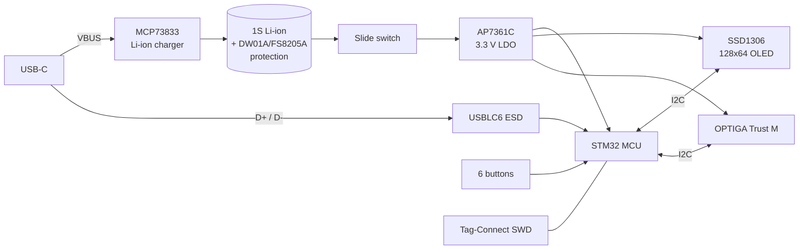

# Sentinel

**Sentinel** is an open-source, low-power hardware security device by **@papathought / [muru.global](https://muru.global)**.
It is built around an STM32 microcontroller, an **Infineon OPTIGA™ Trust M** secure element, a 0.96" 128×64 OLED,
six tactile buttons, a USB‑C port and an on-board single-cell Li‑ion charger.

The same hardware family runs two different firmwares:

| Firmware | What it is | Target board | Source in this repo |
|---|---|---|---|
| **Muru Vault** | Offline password generator + AES‑256 encrypted password vault, 12‑word recovery | Sentinel **V1B** (STM32L442) | ✅ [`Vault/Firmware/`](Vault/Firmware/) |
| **Sentinel Core** `0.1.0-stm32` | Crypto cold wallet (BTC / ETH, BIP39, PIN, USB host link) | Sentinel **V1B** (STM32L442) | ❌ prebuilt `sentinel_stm32.hex` only |

---

## Hardware revisions

| | **Sentinel V1B** | **Sentinel V1C ("2MB")** |
|---|---|---|
| Folder | [`Vault/`](Vault/) | [`Cold Wallet/Hardware/`](Cold%20Wallet/Hardware/) |
| MCU | STM32L442KCU6 — Cortex‑M4F, 256 KB flash / 64 KB RAM, UFQFPN‑32 | STM32U585CIT6 — Cortex‑M33 + TrustZone, **2 MB** flash / 786 KB RAM, LQFP‑48 |
| Secure element | OPTIGA Trust M, always powered, shares I²C1 with OLED | OPTIGA Trust M on its **own I²C2 bus**, behind a **load switch** (MCU can power‑cycle it) |
| Battery fuel gauge | — | MAX17048 (I²C, alert line to MCU) |
| PCB | 2 layers, ≈ 45.3 × 73.8 mm, OLED + power switch on the back | 4 layers, ≈ 39.1 × 73.8 mm, all parts on top |
| Status | Fabricated (Gerbers in [`Vault/Sentinel-V1B Gerber.zip`](Vault/Sentinel-V1B%20Gerber.zip)), firmware running | Design in progress, 3D models / renders available, no firmware yet |
| Docs | [Hardware V1B](docs/hardware/sentinel-v1b.md) | [Hardware V1C](docs/hardware/sentinel-v1c.md) |

Circuits that both boards share (charger, battery protection, LDO, OLED, USB‑C, buttons, SWD) are described once in
[Common circuits](docs/hardware/common-circuits.md).

---

## Documentation

| Topic | Document |
|---|---|
| Sentinel V1B board (STM32L442) | [docs/hardware/sentinel-v1b.md](docs/hardware/sentinel-v1b.md) |
| Sentinel V1C / 2MB board (STM32U585) | [docs/hardware/sentinel-v1c.md](docs/hardware/sentinel-v1c.md) |
| Shared circuit blocks | [docs/hardware/common-circuits.md](docs/hardware/common-circuits.md) |
| Muru Vault firmware internals | [docs/firmware/muru-vault.md](docs/firmware/muru-vault.md) |
| Muru Vault user guide | [Vault/Firmware/README.md](Vault/Firmware/README.md) |
| Sentinel Core (prebuilt wallet image) | [docs/firmware/sentinel-core.md](docs/firmware/sentinel-core.md) |
| Building & flashing | [docs/firmware/flashing.md](docs/firmware/flashing.md) |
| Design review notes & known issues | [docs/review-notes.md](docs/review-notes.md) |
| Original STM32 + OPTIGA migration plan | [Vault/ARCHITECTURE.md](Vault/ARCHITECTURE.md) |

---

## Tools used

| Tool | Version seen in project files |
|---|---|
| KiCad (Eeschema / Pcbnew) | 10.0.5 |
| GNU Arm Embedded (`arm-none-eabi-gcc`) | 14.3.1 (bundled with STM32CubeIDE 2.2.0) |
| STM32CubeProgrammer | used via ST‑LINK V2 over SWD |
| Python 3 | wordlist tooling in `Vault/Firmware/tools/` |
| Blender | renders in `Cold Wallet/3D/` |

## Credits

Hardware and firmware by **@papathought** — [muru.global](https://muru.global).
Third-party code: QR generator by Richard Moore (MIT, `qrcodegen.c`), public-domain SHA‑256 / AES‑256
implementations, the official BIP39 English wordlist, and an Estonian wordlist derived from
OpenSubtitles 2018 frequency data (hermitdave/FrequencyWords).
